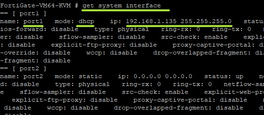
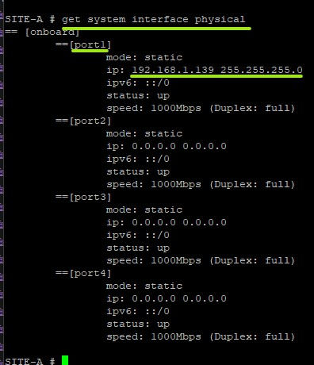
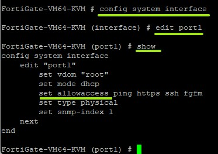
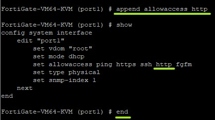
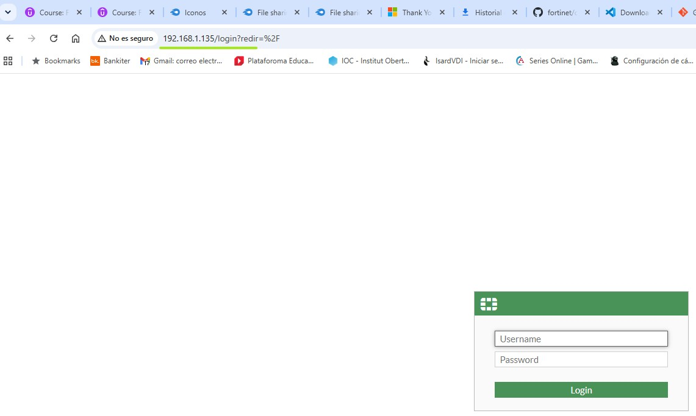
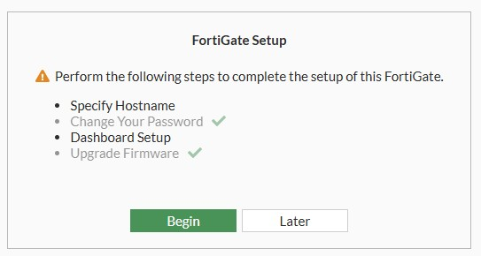
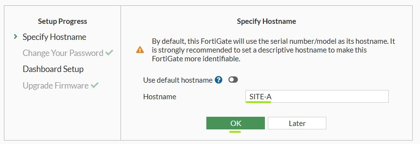
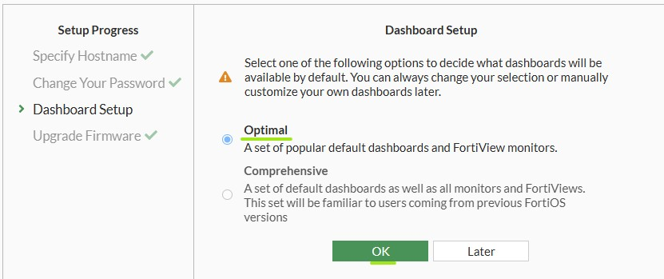
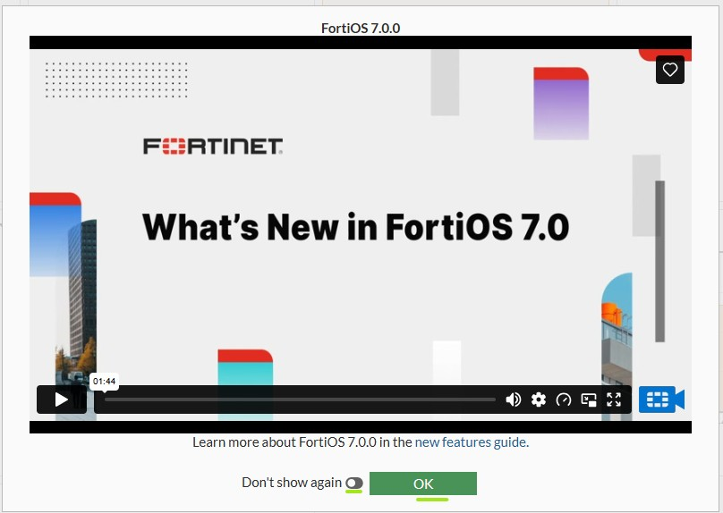
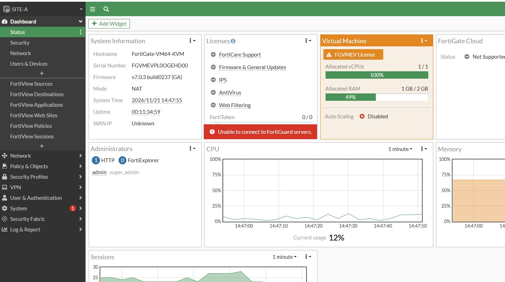

# Primer accès al nostre Firewall

Aquesta guia mostra com consultar les interfícies de xarxa, habilitar l'accés HTTP a `port1` i completar la configuració inicial des del navegador.

## 1. Consultar les interfícies de xarxa

Per consultar totes les interfícies i la configuració definida a FortiGate, executa:

```bash
get system interface
```


*Exemple dels adaptadors de xarxa configurats al Fortinet.*

Per obtenir únicament informació sobre les interfícies físiques, executa:

```bash
get system interface physical
```

---

## 2. Habilitar l'accés HTTP a `port1`

Entra a la configuració de les interfícies i consulta la configuració actual de `port1`:

```bash
config system interface
edit port1
show
```

Un cop situat dins la configuració de `port1`, afegeix HTTP als mètodes d'accés permesos i desa els canvis:

```bash
append allowaccess http
show
end
```



*Configuració inicial de `port1`.*



*L'accés HTTP apareix a la configuració. La comanda `end` desa els canvis i surt del menú.*

### Treure l'accés HTTP

Per desactivar l'accés HTTP de `port1`, executa:

```bash
config system interface
edit port1
unselect allowaccess http
show
end
```

---

## 3. Accedir a la interfície web

Obre l'adreça IP de `port1` en un navegador. Canvia l'adreça de l'exemple si el teu Fortinet en té una de diferent:

```text
http://192.168.1.139
```



*Pàgina d'accés al Fortinet des del navegador.*

Introdueix les credencials de l'exemple:

```text
admin
admin
```

## 4. Completar la configuració inicial

Segueix els passos que es mostren a la interfície web:

1. A la pantalla inicial, fes clic a «Begin».

   

2. Tria el nom d'amfitrió del Fortinet i fes clic a «OK».

   

3. Selecciona l'estil «Optimal» per al tauler. Aquest estil està disponible a partir de la versió 6.4.

   

4. Si no vols tornar a veure el vídeo introductori, selecciona «Don't show again» i fes clic a «OK».

   

Quan acabis, veuràs la interfície web del Fortinet:



---

## Resum de les comandes

Consultar les interfícies:

```bash
get system interface
```

Consultar la configuració del `port1`:

```bash
config system interface
edit port1
show
```

Habilitar HTTP al `port1`:

```bash
config system interface
edit port1
append allowaccess http
show
end
```

Accedir a la interfície web (canvia la IP per la del `port1`):

```text
http://192.168.1.139
```

Treure l'accès HTTP de `port1`:

```bash
config system interface
edit port1
unselect allowaccess http
show
end
```
