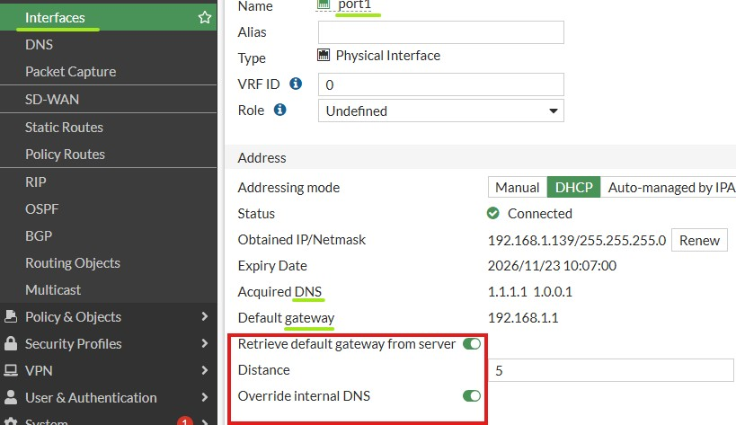
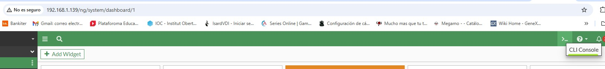
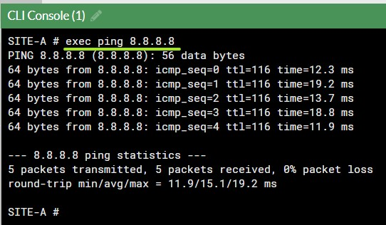
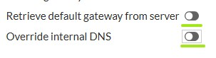
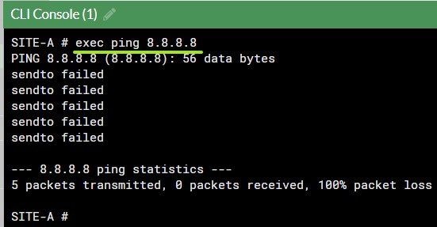
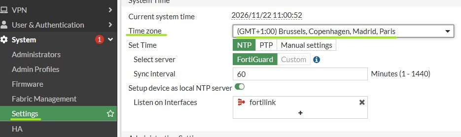
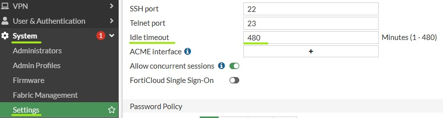
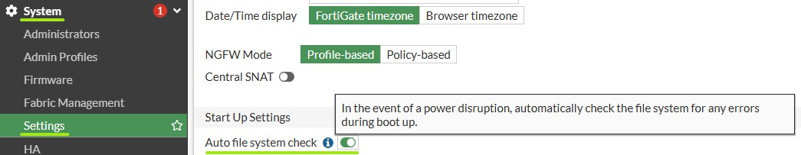

# Ajustant les configuracions inicials
Per defecte, el port1 està configurat perquè obtingui automàticament, mitjançant DHCP, una adreça IP, els servidors DNS i la porta d'enllaç del proveïdor d'Internet.



## 1. Impedir que el `port1` d'administració accedeixi a Internet.

Accedim a la consola des de l'entor web:



Fem un ping per verificar que tenim accés a Internet des de el nostre firewall:

```bash
exec ping 8.8.8.8
```



Desactivarem les següents opcions del `port1` del les opcions enmarcades en vermell.:



*Clic a OK per guardar els canvis.*

Verifiquem de nou des de la consola que no tinguem accés 

Accedim a la consola des de l'entor web:


Fem un ping per verificar que tenim accés a Internet des de el nostre firewall:

```bash
exec ping 8.8.8.8
```


*No hauríem de tenir accés a Internet.*

## 2. Configurar la zona horaria i el Idle timeout.

Accedim al menú `System` i després a l'apartat `Settings`i configurem la nostre zona horaria.



Configurem el "Idle timeout" a 480 al tractar-se d'un laboratori.



Activarem el "Auto file system check" perquè revisi automàticament el sistema d'arxius del nostre firewall en cas que s'apagui de manera incorrecte.



*Clic a `Apply` per guardar els canvis.*

---

## Resum de les comandes

Comprovar la connectivitat a Internet des del Fortinet (abans i després de modificar la configuració del `port1`):

```bash
exec ping 8.8.8.8
```
