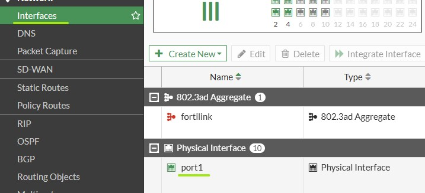
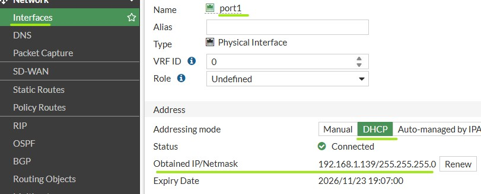
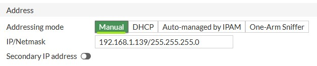
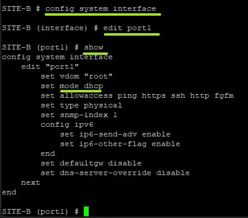
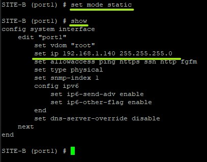
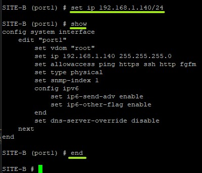

# Configurar IP estàtica en el nostre Firewall

Configurarem el nostre firwall amb una IP estàtica en lloc d'una IP donada pel nostre router de Internet.

## 1. Primer farem un exemple des de l'entorn web

Accedim al menú `Interfaces` i després doble clic `port1` de `Physical Interface`.



*Fem doble clic al `port1`.*



*Aquesta és la configuració actual per DHCP.*

En seleccionar `Manual`, el FortiGate proposa com a adreça IP estàtica la mateixa adreça que havia rebut per DHCP. Pots mantenir-la o introduir-ne una altra de lliure dins la mateixa subxarxa. Abans de mantenir-la, comprova que el servidor DHCP no la pugui assignar també a un altre dispositiu, per evitar conflictes d'adreces IP.



## 2. Ara ho farem per línia d'ordres

Accedim a la configuració de les interfícies de xarxa i veiem la configuració actual:

```bash
config system interface
edit port1
show
```



Configurem el mode d'adreçament com a estàtic:

```bash
set mode static
```



Per assignar una adreça IP específica a `port1`, executa la comanda següent:

```bash
set ip 192.168.1.140/24
show
```



*En aquest cas he assignat la mateixa IP que la proposada i fem `end`per guardar la configuració.*