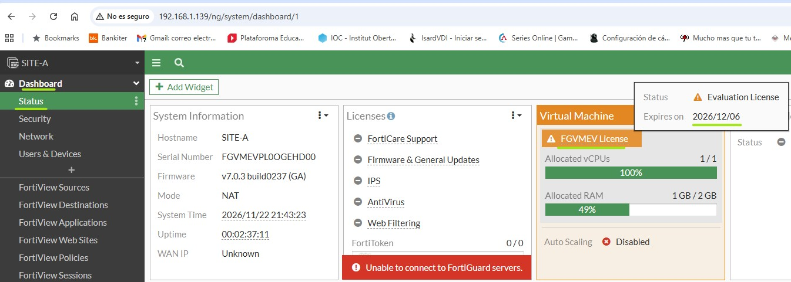
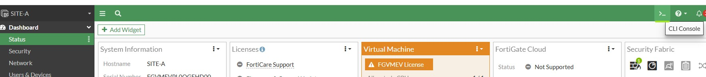
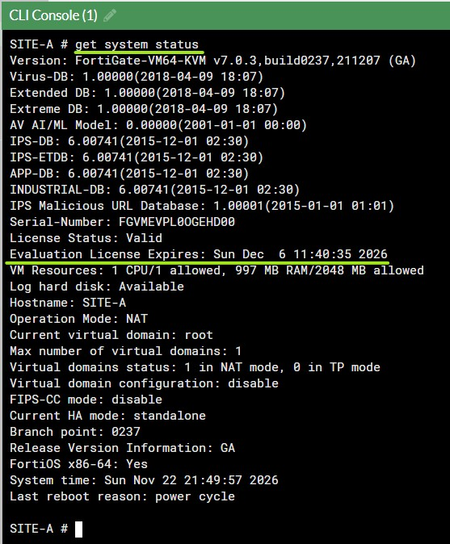

# Verificar la llicència d'avaluació del nostre Fortinet

Aquesta guia explica com consultar l'estat de la llicència d'avaluació del Fortinet.



*Veiem un exemple de com mirar-ho des de l'entorn web d'un dels nostres Firewalls.*

Aquesta informació també la podem veure mitjà de la consola CLI del firewall amb la següent comanda:



```bash
get system status
```



*Veiem la informació general del nostre firewall.*