# Configuració de les interfícies del nostre laboratori Fortinet

Aquesta guia recollirà els passos per consultar i configurar les interfícies de xarxa del Fortinet.

Partim d'aquest escenari inicial per posar en context les següents configuracions.

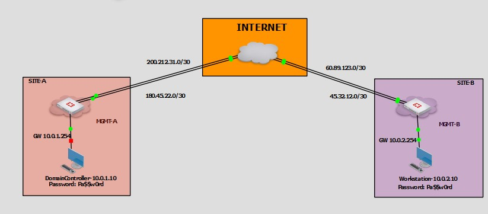

## **Configuració del primer Forntinet per entorn web**

## 1. Configuració del `port2` amb la configuració del primer proveïdor Internet del nostre laboratori des de l'entorn web.

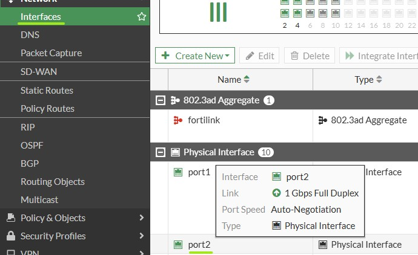

*Dins l'apartat `Interfaces` del nostre Fortinet fem doble clic sobre el `port2` per accedir a la configuració de la interfície.*

Un cop oberta la configuració del `port2`, hi indiquem un nom descriptiu al camp `Alias`, seleccionem `WAN` al camp `Role` i hi configurem l'adreça IP corresponent al primer proveïdor d'Internet del laboratori. 

Evitem donar accessos administratius aquestes interfícies donat que seria una mala pràctica.

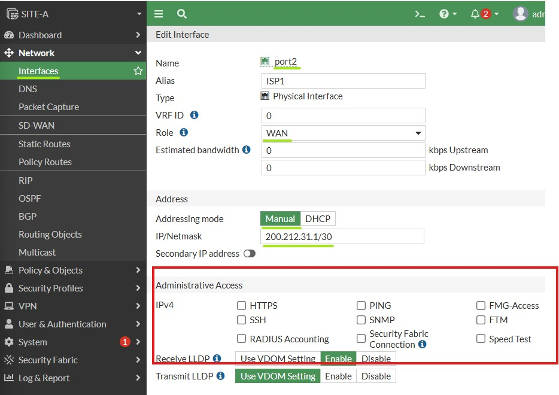

*Per guardar els canvis fem clic `OK`*


*Així quedaria un cop configurat*

## 2. Configuració del `port3` amb la configuració del segon proveïdor Internet del nostre laboratori des de l'entorn web.

Un cop oberta la configuració del `port3`, hi indiquem un nom descriptiu al camp `Alias`, seleccionem `WAN` al camp `Role` i hi configurem l'adreça IP corresponent al segon proveïdor d'Internet del laboratori. 


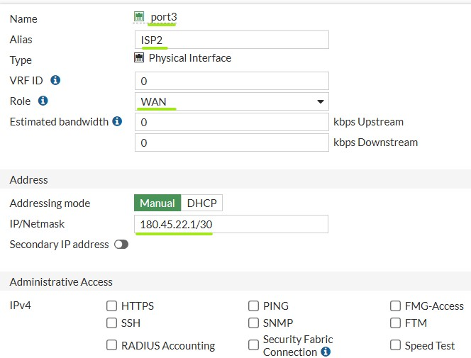

El resultat d'aquestes dues configuracions serà aquest

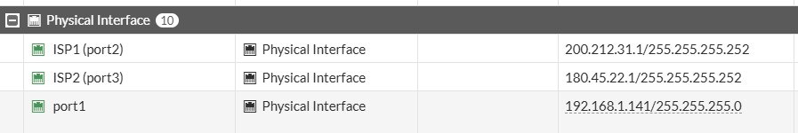

*Tindrem configurats el `port1` per l'administració del nostre Fortinet i el `port2` i `port3` amb els dos proveïdors d'Internet amb les seves corresponents portes d'enllaç.*

Podem verificar aquestes configuracions des de la nostra consola fent un pin a les portes d'enllaç que hem configurat.

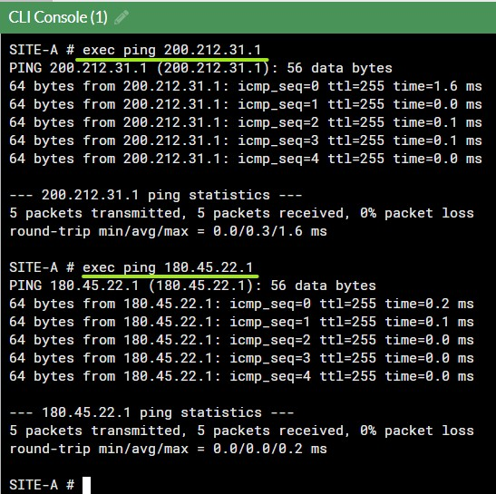

*Com podem veure tenim resposta.*

Tot i això, encara no tenim accés a Internet: ens falta configurar la ruta per defecte al nostre firewall. Ho farem de la manera següent:

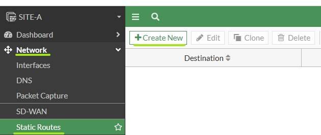

Afegim la primera ruta pel nostre primer ISP

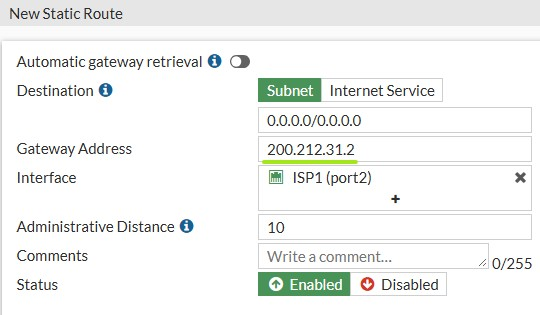

*Fem `OK` per guardar la nova ruta*

Afegim la segona ruta pel nostre segon ISP

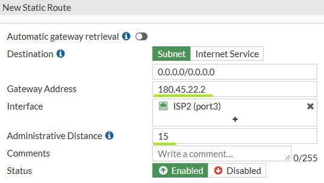

*En la segona ruta posem una `Administrative Distance` més alta que veurem més endavant quina utilitat té i fem `OK` per guardar la nova ruta*

Ara podem verificar que també tenim accés a Internet fent un ping per exepmple a `www.google.com`.


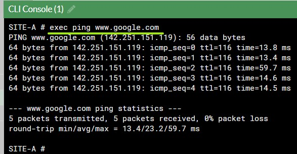

*En aquest cas la sortida a Internet, l'està fent pel primer proveïdor perquè la distància administrativa més baixa*

## 3. Configuració del `port4` que serà la interfície `LAN` de la nostra xarxa interna.

En aquest punt configurarem la interfície que utilitzarem per donar accés Als equips de la nostra lan interna del nostre laboratori.

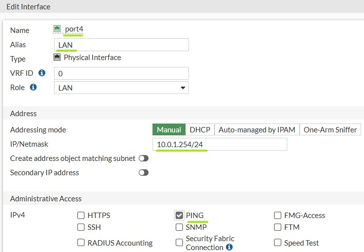

*En aquest cas dins l'apartat `Administrative Acces` activarem el `PING` i `OK` per guardar els canvis.*

La configuració final de totes les nostres interfícies serà la següent:

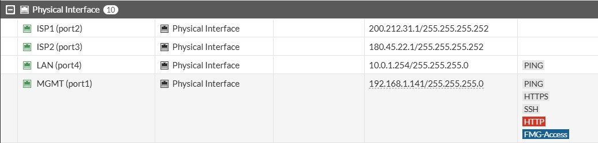

*Hem afegit un àlies al port d'administració `MGMT` amb un rol de `LAN`.*

## **Configuració del segon Forntinet**

## 1. Configuració del `port2` amb la configuració del primer proveïdor Internet del nostre laboratori des de la consola.

Obrim la `CLI` i accedim al nostre segon firewall.

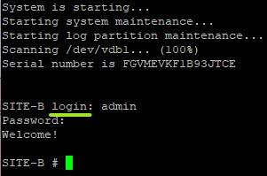

*Ho farem utilitzant alguna eina com el putty.*

Per configurar totes les interfíes i veure la seva configuració inicial farem la següent comanda :

```text
config system interface
show
```

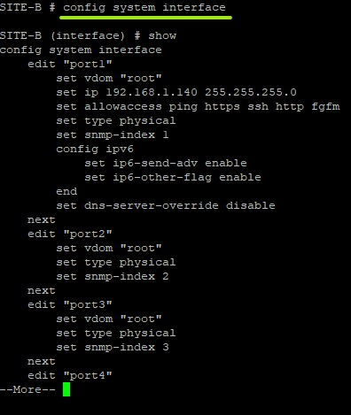

*Aquesta es la configuració inicial del firewall.*

## 1. Editar el port `port2`.

El primer que farem serà editar la configuració del port2 des de la consola CLI dins de la configuració .

```text
edit port2
show
```

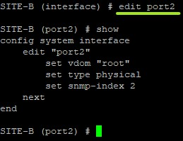