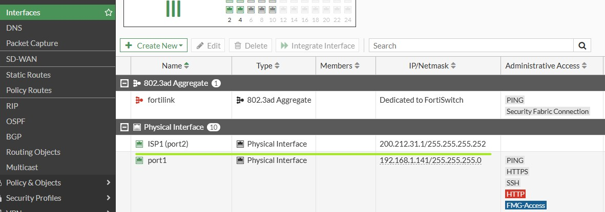

# Configuració de les interfícies

Aquesta guia recollirà els passos per consultar i configurar les interfícies de xarxa del Fortinet.

## Configurarem el `port2` amb la configuració del primer proveïdor Internet del nostre laboratori des de l'entorn web.

*Dins l'apartat `Interfaces` del nostre Fortinet fem doble clic sobre el `port2` per accedir a la configuració de la interfície.*

Un cop oberta la configuració del `port2`, hi indiquem un nom descriptiu al camp `Alias`, seleccionem `WAN` al camp `Role` i hi configurem l'adreça IP corresponent al primer proveïdor d'Internet del laboratori. 

Evitem donar accesos administratius aquestes interfícies donat que seria una mala pràctica.

*Per guardar els canvis fem clic `OK`*

*Així quedaria un cop configurat*
