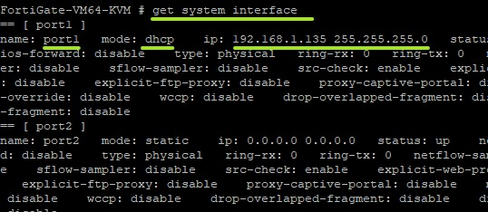
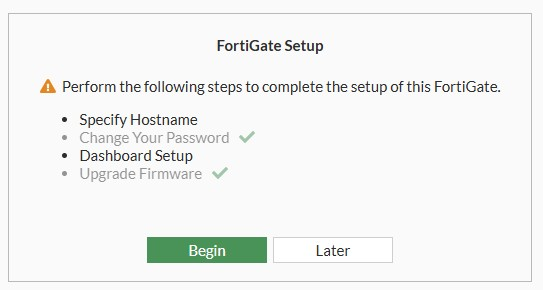

## Primeres configuracions i activació de l'accés HTTP en un Fortinet de laboratori

### Consultar els adaptadors de xarxa del Fortinet

Executem la comanda següent per consultar la configuració actual dels adaptadors de xarxa del nostre Fortinet.

```bash
get system interface
```



*Exemple dels adaptadors de xarxa configurats al Fortinet.*

### Activar HTTP als Fortinets de laboratori

Consultem la configuració actual de `port1`.

```bash
config system interface
edit port1
show
```


*Exemple de la configuració inicial de `port1` a l'adaptador de xarxa del Fortinet.*

### Activar l'accés HTTP al Fortinet de laboratori

Afegim l'accés HTTP, mostrem la configuració i desem els canvis.

```bash
append allowaccess http
show
end
```


*Exemple de l'accés afegit. Comprovem que apareix i desem els canvis amb la comanda `end`.*

### Accedir al Fortinet des d'un navegador mitjançant HTTP

```bash
http://192.168.1.139
```


Introduïm les credencials d'accés:

```bash
admin
admin
```

*Exemple d'accés al Fortinet mitjançant el navegador i el protocol HTTP.*

## Primeres configuracions des de l'entorn web



*Fem clic a «Begin».*

## Configurar el nom d'amfitrió del Fortinet


*Escollim el nom i fem clic a «OK».*

## Triar l'estil del tauler (Dashboard)


*Escollim «Optimal», el nou estil disponible a partir de la versió 6.4.*

## Vídeo introductori de la versió 7


*Seleccionem «Don't show again» i fem clic a «OK».*

## Accedir a la interfície web del Fortinet


*Exemple d'accés a la interfície web.*

## Resum de les comandes treballades

Consultar les interfícies de xarxa:

```bash
get system interface
```

Consultar la configuració de `port1` i habilitar-hi l'accés HTTP:

```bash
config system interface
edit port1
show
append allowaccess http
show
end
```

Treure l'accés HTTP de `port1`:

```bash
config system interface
edit port1
unselect allowaccess http
show
end
```

Accedir a la interfície web del Fortinet (substitueix l'adreça per l'adreça IP de `port1`):

```text
http://192.168.1.139
```
